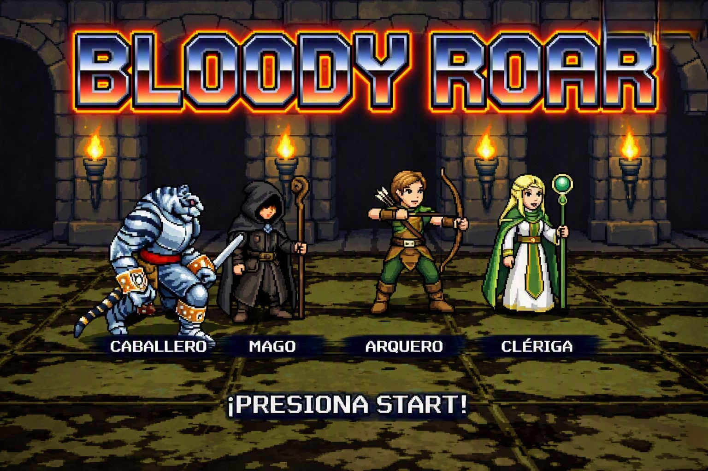
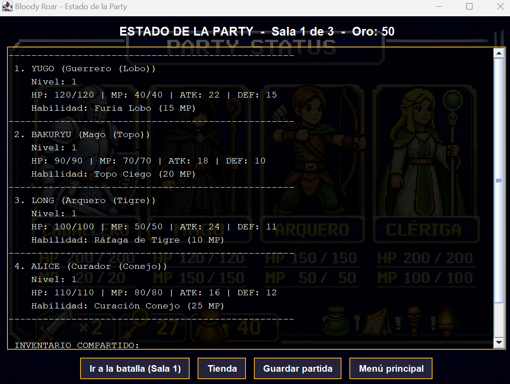
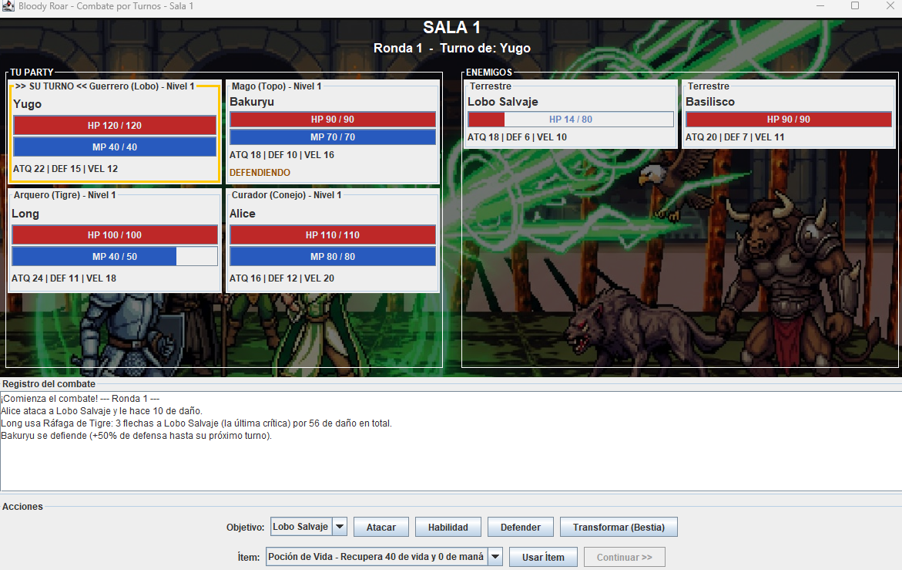
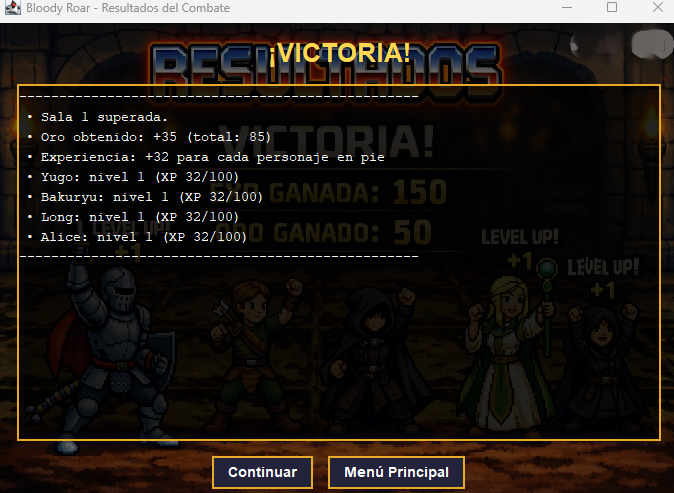

# GRUPO 6 — RPG por Turnos: Bloody Roar

**Paradigma Orientado a Objetos — UADE · Trabajo Práctico Integrador**

## Integrantes

- Culshaw, Federico: LU1174721
- Costana lazo, Joselin: LU1218192
- Bergantino, Adriel A.: LU1111637
- Moragas, Catalina: LU1177331

---

## Bloody Roar

Juego de rol por turnos en el que se controla a una party de 2 a 4 combatientes que debe superar **3 salas** de combate consecutivas, la última contra un jefe. No hay exploración de mapa: el foco está en la estrategia y en la gestión de recursos (vida, maná, ítems y oro).

## Cómo ejecutar el proyecto

Requiere Java 8 o superior.

1. Clonar el repositorio:
   ```
   git clone https://github.com/cmoragasuade/POO_-Bloody-ROAR.git
   ```
2. Importarlo en Eclipse: *File → Import → Existing Projects into Workspace* y seleccionar la carpeta clonada.
3. Verificar que la carpeta `src` esté configurada como *Source Folder* (las imágenes se cargan desde `src/resources`).
4. Ejecutar la clase `main.Main` (*Run As → Java Application*).

Existe además `test.MainPruebas`, que juega las 3 salas por consola usando solo el modelo (sin interfaz gráfica).

## Arquitectura (MVC)

| Paquete | Responsabilidad |
|---|---|
| `modelo` | Lógica de negocio y estado: entidades, batalla, party, ítems, tienda y fábricas. No depende de Swing. |
| `vista` | Pantallas Swing (inicio, selección de personajes, estado de la party, tienda, batalla y resultados). Solo muestran información y avisan qué se tocó. No contienen reglas de negocio. |
| `vista.paneles` | Componentes reutilizables de la vista (`PanelFondo`, `PanelEstadoEntidad`, `PanelRegistro`). |
| `controlador` | `GameManager` coordina el flujo del juego y la persistencia; `ControladorBatalla` recibe las acciones de la pantalla de batalla; `ConversorDTO` convierte objetos del modelo en DTOs; `PartidaException` representa los errores de guardado y carga. |
| `dto` | Objetos de transferencia de datos (`EntidadDTO`, `ItemDTO`, `EstadoPartidaDTO`, `EstadoBatallaDTO`, `ResultadoBatallaDTO`) con lo que la vista necesita mostrar, sin exponer el modelo. |
| `util` | Utilidades de apoyo (carga de imágenes). |

Flujo de una acción: el usuario interactúa con la vista → la vista notifica al controlador → el controlador llama al modelo → el modelo cambia su estado → la vista se actualiza con un DTO nuevo.

### Patrones y principios aplicados

- **Singleton:** `GameManager`, porque hay una sola partida en curso.
- **Factory:** `EnemigoFactory` (arma los enemigos de cada sala) e `ItemFactory` (crea cada ítem del juego).
- **DTO:** las vistas reciben copias de los datos, nunca el modelo.
- **Comparator:** `ComparadorPorVelocidad` ordena la cola de turnos.
- **GRASP:** *Controller* (`GameManager`, `ControladorBatalla`), *Information Expert* (cada entidad calcula y protege su propio estado), *Creator* (las fábricas), *Pure Fabrication* (`ConversorDTO`), *Polymorphism* (personajes, enemigos e ítems con comportamiento propio) y *Low Coupling / High Cohesion* mediante la separación en MVC.

---

## Flujo del juego

1. **Pantalla inicial:** iniciar nueva partida, cargar partida guardada, abrir la tienda (requiere partida en curso) o salir.
2. **Selección de personajes:** se eligen entre 2 y 4 de los 4 combatientes disponibles. La party comienza con 50 de oro y 2 Pociones de Vida.
3. **Estado de la party:** muestra la sala actual, el oro, las estadísticas de cada personaje y el inventario compartido. Desde acá se va a la batalla, a la tienda, se guarda la partida o se vuelve al menú.
4. **Batalla:** combate por turnos contra los enemigos de la sala.
5. **Resultados:** muestra victoria (con recompensas) o derrota. Tras una victoria se puede continuar con la sala siguiente. Si se vence al jefe de la sala 3 se gana el juego; si toda la party cae es *Game Over* y se descarta la partida en curso al volver al menú.

---

## Personajes

Todos los personajes (clase abstracta `Personaje`) tienen nombre, vida, maná, ataque, defensa, velocidad, nivel y experiencia, y heredan de `Entidad`.

| Personaje | Clase | Vida | Maná | Ataque | Defensa | Velocidad |
|---|---|---|---|---|---|---|
| Yugo (Lobo) | Guerrero | 120 | 40 | 22 | 15 | 12 |
| Bakuryu (Topo) | Mago | 90 | 70 | 18 | 10 | 16 |
| Long (Tigre) | Arquero | 100 | 50 | 24 | 11 | 18 |
| Alice (Conejo) | Curador | 110 | 80 | 16 | 12 | 20 (15 base + 5 de bonificación) |

### Guerrero (Yugo - Forma Lobo)

Especialista en resistencia: mucha vida y defensa.

- `probabilidadBloqueo` (20%) y `escudoAbsorcion` (10): al recibir un golpe, con 20% de probabilidad se bloquea y el daño entrante se reduce en 10 antes de aplicar la defensa.
- `furiaLobo`: bonus de ataque que calcula `activarFuriaLobo()` según la vida restante: **+10%** del ataque con vida de 50% o más, **+20%** con menos de 50%, **+30%** con menos de 25% y **+50%** con menos de 5%.
- **Habilidad - Furia Lobo** (15 MP): aplica ese bonus de ataque durante 3 turnos como `EfectoEstado` y golpea al objetivo.

### Mago (Bakuryu - Forma Topo)

Atacante mágico con mucho maná y velocidad.

- `poderMagico` (15): se suma al ataque en el daño de su habilidad.
- `probabilidadEfectoEstado` (30%) y `estaBajoTierra`: estado que le permite esquivar por completo el próximo golpe recibido.
- **Habilidad - Topo Ciego** (20 MP): daño mágico de un objetivo (ataque + poder mágico, reducido por la defensa del enemigo). Con 30% de probabilidad el mago se oculta bajo tierra y esquiva el próximo golpe.

### Arquero (Long - Forma Tigre)

Atacante rápido con mucho ataque y velocidad.

- `probabilidadCritico` (25%) y `multiplicadorCritico` (1.5x): su ataque básico puede ser crítico.
- `cargasInstintoTigre`: contador que suma una carga por cada ataque básico y se reinicia al usar su habilidad.
- **Habilidad - Ráfaga de Tigre** (10 MP): 3 flechas seguidas al mismo objetivo. Las dos primeras hacen el 80% del ataque y la tercera es siempre crítica (1.5x).

### Curador (Alice - Forma Conejo)

Soporte de la party.

- `potenciaCurativa` (30): vida que restaura su curación.
- `bonificadorAgilidad` (5): puntos extra de velocidad que se suman a su velocidad base.
- `resistenciaEfectos` (20%): atributo previsto para ignorar efectos negativos; queda reservado para futuras ampliaciones.
- **Habilidad - Curación Conejo** (25 MP): cura 30 de vida a todos los personajes vivos de la party. No necesita objetivo enemigo.

### Transformación en Bestia (todos los personajes)

Un personaje puede gastar 10 MP para transformarse: gana **+5 de ataque y +3 de defensa durante 3 turnos**. No se puede transformar si ya está transformado o si no tiene maná. La transformación termina sola y también al finalizar la batalla.

---

## Enemigos

Los enemigos (clase abstracta `Enemigo`, que hereda de `Entidad`) atacan durante su turno a un personaje vivo elegido al azar y, al ser derrotados, otorgan experiencia y oro. Cada tipo tiene un comportamiento propio:

- **EnemigoTerrestre:** enemigo estándar, sin ventajas especiales.
- **EnemigoVolador:** tiene 25% de probabilidad de esquivar por completo cada golpe que recibe.
- **EnemigoBoss:** su ataque crece con la fase (+5 por número de fase). Al bajar al 50% de vida o menos pasa a la **fase 2** y gana +10 de ataque. La interfaz avisa el cambio de fase.

### Salas

| Sala | Enemigos (vida / ataque / defensa / velocidad) | XP | Oro |
|---|---|---|---|
| 1 | Lobo Salvaje (80/18/6/10) | 60 | 15 |
| 1 | Basilisco (90/20/7/11) | 70 | 20 |
| 2 | Jabalí Feroz, terrestre (110/24/9/9) | 90 | 25 |
| 2 | Murciélago Gigante, volador (70/22/5/17) | 80 | 25 |
| 2 | Halcón Sombrío, volador (75/23/6/19) | 85 | 30 |
| 3 | Busuzima, jefe (320/30/12/14) | 300 | 120 |

---

## Reglas del combate

- **Daño:** `Daño = Ataque − Defensa del objetivo`. Si el resultado es menor a 1, el daño es 1. El bonus de las armas equipadas ya está sumado al ataque del personaje.
- **Orden de turnos:** `Batalla` arma una `colaTurnos` (`List<Entidad>`) con todos los vivos, ordenada de mayor a menor velocidad. Los empates se resuelven al azar. La cola se recalcula al comenzar cada ronda.
- **Acciones del jugador en su turno:** atacar, defender, usar habilidad, transformarse o usar un ítem. Si una habilidad no alcanza en maná, el personaje no pierde el turno.
- **Defender:** suma 50% extra a la defensa hasta el próximo turno de ese personaje.
- **Turno enemigo:** los enemigos juegan automáticamente (ataque básico).
- **Fin de la batalla:** gana la party cuando todos los enemigos caen; pierde si todos los personajes caen.

### Recompensas

- La **experiencia total** de los enemigos derrotados se reparte en partes iguales entre los personajes que siguen vivos.
- El **oro** total va al oro compartido de la party.
- Los personajes caídos se recuperan con un cuarto de su vida máxima para la siguiente batalla.

---

## Progresión

- **Experiencia necesaria** para subir del nivel N al N+1: `N × 100` (nivel 1 a 2 = 100 XP, nivel 2 a 3 = 200 XP). Si la experiencia alcanza para varios niveles, se suben todos.
- **Al subir de nivel** (`verificarSubidaNivel()` → `subirNivel()`): +20 de vida máxima, +10 de maná máximo, +5 de ataque y +3 de defensa, y se restauran vida y maná al 100%.

---

## Ítems, inventario y tienda

La clase abstracta `Item` define lo común a todos los objetos (id, nombre, precio) y cada tipo decide su efecto en `aplicar()`. El **inventario y el oro son compartidos** por toda la `Party`.

| Ítem | Tipo | Precio | Efecto |
|---|---|---|---|
| Poción de Vida | Consumible | 20 | +40 de vida |
| Poción de Maná | Consumible | 15 | +30 de maná |
| Elixir | Consumible | 45 | +60 de vida y +40 de maná |
| Garra de Lobo | Arma (equipable) | 60 | +6 de ataque |
| Arco del Tigre | Arma (equipable) | 70 | +8 de ataque |

- **Consumibles:** se gastan al usarse sobre el personaje que tiene el turno.
- **Equipables:** no se gastan. Al equiparse suman su bonus al personaje, y si ya tenía un arma se le quita primero el bonus anterior.
- **Tienda:** se accede desde el menú principal (con una partida en curso) y desde la pantalla de la party. Cada compra descuenta oro y agrega un ítem nuevo al inventario, creado por `ItemFactory`.

## Efectos de estado

`EfectoEstado` encapsula una alteración temporal con nombre, duración y valor (suma al ataque mientras dura). Su duración baja al comenzar cada turno del personaje y, al vencer, el bonus se revierte. Todos los efectos se limpian al terminar la batalla. Actualmente lo usa la habilidad Furia Lobo.

---

## Persistencia (guardado de partida)

`GameManager` guarda y carga la partida en el archivo local `partida.dat` mediante serialización de objetos (`ObjectOutputStream` / `ObjectInputStream`, con `try-with-resources`). Se guarda la `Party` completa (personajes con nivel, experiencia, vida, maná y arma equipada, oro e inventario) y la sala en la que se encuentra la partida.

- **Restricción:** solo se guarda fuera de combate, desde la pantalla de estado de la party.
- Los problemas de guardado o carga se informan con la excepción propia `PartidaException` (por ejemplo, al cargar sin partida guardada).

---

## Capturass

### Pantalla Inicial



### Pantalla de Estado de la Party



### Pantalla de Batalla



### Pantalla de Resultados



---

## Documentación de diseño (Fase A)

- Diagrama de clases: `DDC.jpeg`
- Diagramas de secuencia: `DDS1..txt` y `DDS2..txt`
- Documento de diseño: `BLOODY ROAR.pdf`

### Pantalla Inicial


### Pantalla de Estado de la Party


### Pantalla de Batalla


### Pantalla de Resultados


---

## Documentación de diseño (Fase A)

- Diagrama de clases: `DDC.jpeg`
- Diagramas de secuencia: `DDS1..txt` y `DDS2..txt`
- Documento de diseño: `BLOODY ROAR.pdf`
